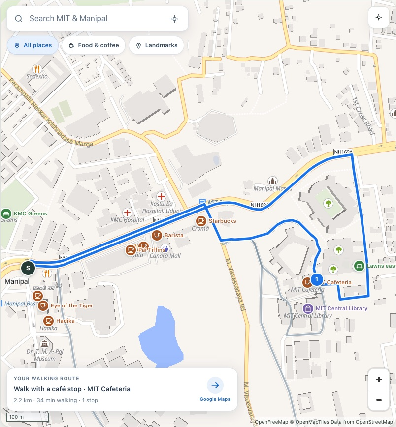

# Campus Loops

Plan a walk around MIT Manipal that fits your time, budget and occasion, with a route and a timer for getting back.

**Live demo:** [Campus Loops on GitHub Pages](https://deftsalt-debug.github.io/campus-loops/)



## What it does

- Suggests up to three walks for an occasion, start, time limit and budget.
- Supports required stops, visit durations, a return buffer, sunset and back-by constraints.
- Shows routes on a street map, with optional Google Maps venue discovery.
- Shares and saves plans locally, exports itineraries, and guides a walk with a live timer.
- Records local field notes and walking-time observations for later review.

## Run locally

Use Node.js 24 (also supported: Node 22 from 22.12, and Node 26 or newer):

```bash
git clone https://github.com/Deftsalt-debug/campus-loops.git
cd campus-loops
npm ci
npm run dev
```

Open [localhost:5173](http://localhost:5173). No API key is required for the default map.
After sunset, use the preview-time control to plan a daytime walk.
Optional map configuration and the release checklist are in [local development](docs/LOCAL_DEVELOPMENT.md).

## Tests

```bash
npm run verify
```

Runs lint, type-checking, unit/invariant tests and a production build.
Browser checks use `npm run test:browser` for real map resources and `npm run test:browser:google` for the stubbed Google integration.
The two Playwright configurations share a base but require different builds; the stub suite makes no paid Google requests.
CI verifies pushes and pull requests; only successful `main` releases deploy to Pages.

## Architecture

| Layer | Implementation |
| --- | --- |
| Interface | React, TypeScript, Vite |
| Planning | Hand-written Dijkstra, binary heap, edge costs and bounded itinerary search |
| Maps | MapLibre/OpenFreeMap by default; optional Google Maps |
| Data | Saved OSM paths, SRTM elevations and explicitly marked demo assumptions |
| State | URL fragments and browser storage; no server or account system |
| Hosting | Static `dist/` build; live GitHub Pages workflow |

See [architecture](docs/ARCHITECTURE.md) and [data provenance](docs/DATA_PROVENANCE.md).

## Known limits

The saved 1 October 2026 map snapshot is not a campus survey. Access, entrances, steps, cover, prices and some hours need field verification.
Walking/visit times and budgets are estimates. A current basemap or Google venue listing does not verify the saved route graph.
Unknown or unsupported data can prevent a stop from being planned. Map availability depends on third-party services; there is no offline map download.
Saved plans and notes belong to this browser/domain; export a backup before moving devices or hosts.
Google Maps is optional and subject to its own billing, quotas and policies. The default map needs no key.

## Licence

Code: [MIT](LICENSE). OSM-derived data remains © OpenStreetMap contributors under [ODbL 1.0](https://www.openstreetmap.org/copyright).
The code licence does not replace data/provider terms; see [data provenance](docs/DATA_PROVENANCE.md).

## Credits

Built by [Deftsalt-debug](https://github.com/Deftsalt-debug); existing contributor and AI co-author credit remains in Git history.
Map data: OpenStreetMap contributors. Default basemap: OpenFreeMap/OpenMapTiles. Elevation: SRTM via OpenTopoData.
See [contributing and security reporting](CONTRIBUTING.md).
